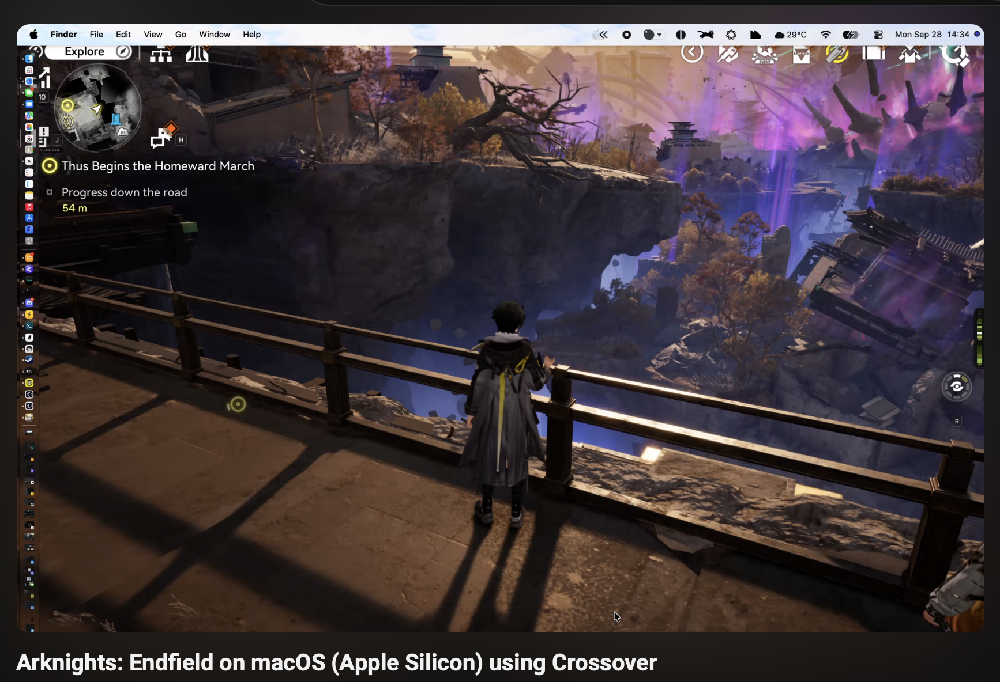

[](https://github.com/stoicswe/Endfield_FineWine/actions/workflows/build.yml) [](https://github.com/stoicswe/Endfield_FineWine/actions/workflows/nightly.yml) [](https://github.com/stoicswe/Endfield_FineWine/actions/workflows/update-wiki.yml)

# Endfield_FineWine — Arknights: Endfield on Apple Silicon

[](https://www.youtube.com/watch?v=baokvOArBKc)

Run **Arknights: Endfield** and other Windows games on an Apple Silicon Mac. This repository holds two projects that share that goal:

- **[FineWine](#finewine-standalone)** — a standalone menu bar app with its own Wine. It needs no CrossOver and no Rosetta 2.
- **[FineWine Patcher](#finewine-patcher)** — an app that patches a copy of your licensed CrossOver so the game's protection and the **ACE anti-cheat** run on macOS as they do on Windows.

Project website: **[endfield-finewine.web.app](https://endfield-finewine.web.app)**

⚠️ Both are provided as-is. Neither bypasses anti-cheat: they change the Wine environment so that the game's own anti-cheat services run uninterrupted. Using them is your choice and the risk is yours.

> **Scope & ethics:** own the game; this is compatibility work (the same category as Valve's Proton on Linux) — no in-game advantage, no modified game logic, no DRM circumvention. Running a game in an unsupported configuration may violate its Terms of Service. Not affiliated with Gryphline/Hypergryph, Tencent, CodeWeavers, or Apple. The repository does not contain or redistribute CrossOver, Apple's Game Porting Toolkit, or any game.

| | FineWine (standalone) | FineWine Patcher |
|---|---|---|
| What it is | Its own app and Wine runtime | Patches for a CrossOver you own |
| Needs CrossOver | No | Yes, 26.3 (or the ARM preview), licensed |
| Needs Rosetta 2 | No (x64 code runs through FEX) | Yes for the x64 variant |
| macOS | 26 or newer | 15 or newer |
| State | Beta | The established way to play Endfield |
| Details | **[finewine-app/README.md](finewine-app/README.md)** | **[patcher-app/README.md](patcher-app/README.md)** |

---

## FineWine (standalone)

A menu bar app that manages Wine prefixes, runs the programs installed in them and makes a Mac app for each one. Its Wine runtime is built from this repository: native ARM64 Wine, FEX for x64 and 32-bit programs, DXMT for Direct3D 10/11 on Metal and MoltenVK for Vulkan and Direct3D 12.

How to build it, how it is put together, and the licences and upstream projects of everything inside it: **[finewine-app/README.md](finewine-app/README.md)**.

### Quick start

1. Download the newest **FineWine** zip from the [releases page](https://github.com/stoicswe/Endfield_FineWine/releases), unzip it and move `FineWine.app` to `/Applications`.
2. Open it. FineWine lives in the menu bar; its manager window opens from there.
3. Choose **New Prefix**, pick a profile (Standard, or Arknights: Endfield) and give it a name.
4. Right-click the prefix, choose **Run Installer…** and select the game's Windows installer. The programs it installs appear in the prefix's list.
5. Start a program from the list or from the menu bar. **Make Shortcut App** puts it in `~/Applications/FineWine` for Finder, Launchpad and the Dock.

Already have the game in a CrossOver bottle? **Import CrossOver Bottle…** makes a FineWine prefix from a copy of it; the bottle itself is not changed.

> [!NOTE]
> 32-bit Windows programs run too, which is new: installers and ordinary programs have been tried, 32-bit games have not. See the [detailed readme](finewine-app/README.md).

---

## FineWine Patcher

An app that turns a copy of **CrossOver 26.3** into a patched build that runs Arknights: Endfield. Your original CrossOver is never changed.

How to build it, how the patches work, and the licences and upstream projects of everything inside it: **[patcher-app/README.md](patcher-app/README.md)**.

### Quick start

> [!IMPORTANT]
> **Fresh installs: order matters.** Patch CrossOver **first**, then create the bottle and install
> the Gryphline launcher **from the patched app**. CrossOver stamps every program launcher it creates
> with the bundle identifier of the CrossOver that created it, so a bottle or launcher made in the
> stock app keeps opening the **stock** CrossOver. Delete launchers the stock app created
> (`~/Applications/CrossOver/…`) and re-create them from the patched copy.

1. Install [CrossOver 26.3](https://www.codeweavers.com/crossover) (licensed) and Rosetta 2: `softwareupdate --install-rosetta --agree-to-license`.
2. Download the newest **FineWine Patcher** from the [releases page](https://github.com/stoicswe/Endfield_FineWine/releases) and open it.
3. Choose **Automated Setup…**. It creates the patched copy (`/Applications/CrossOver_Endfield_Patch.app`), optionally installs Apple's GPTK4 / D3DMetal 4 from a copy you download yourself, asks for the Gryphline installer, creates the bottle in the patched app and starts the installer. **Create Patched Copy…** does only the first of these.
4. Start the game from the Gryphline launcher in the **patched** app with **Launch with DirectX 11** ([docs/installation.md](docs/installation.md#5-run-the-game)).

Building and deploying from the shell instead, without the app:

```bash
./scripts/build-wine.sh all          # 1. build the patched Wine
./scripts/swap-into-crossover.sh     # 2. deploy into a copy of CrossOver
./scripts/create-bottle.sh           # 3. create the "Arknights Endfield" bottle, then install the launcher into it
open /Applications/CrossOver_Endfield_Patch.app   # 4. run the game from the patched app
```

Full requirements, a manual (auditable) deployment, the bottle setup and launch options: **[docs/installation.md](docs/installation.md)**. Problems: **[docs/troubleshooting.md](docs/troubleshooting.md)**.

---

## Performance

**Patched CrossOver.** Tested on an Apple **M4 Pro** (MacBook Pro 12-core, 24 GB), macOS 27.0, CrossOver 26.2/26.3: **120 FPS on Max settings** with **DXMT + `-force-d3d11`**, about 8–12 GB of RAM. A base M1–M4 with 16 GB reaches about 45–60 FPS on Medium/Low. ⚠️ A **MacBook Air is not recommended** (no active cooling). Expect about 90 °C; performance is bound by CPU and RAM more than by the GPU.

> [!IMPORTANT]
> **GPTK4 is not a DXMT dependency.** DXMT has its own D3D11→Metal implementation and does not load D3DMetal; GPTK4 only changes the separate D3DMetal path.
>
> **DLSS on DXMT depends on the DXMT build.** CrossOver 26.3's bundled DXMT 0.80 has an NGX bug that gives a black screen in Endfield; use **TAAU** or **AMD FSR3** with it. See [DLSS compatibility](docs/technical.md#dlss-under-dxmt-stock-and-patched-builds).

**FineWine standalone.** Measured layer by layer, not yet as game frame rates: on an Apple M3, x64 code under FEX runs integer and memory work at about native speed, and a Direct3D 11 frame of 10,000 draws takes 6.0 ms as ARM64 and 8.3 ms as x64. MSync, automatic MetalFX upscaling and Game Mode are on by default.

More:

- [docs/performance.md](docs/performance.md) — FPS targets per chip, thermals, swap pressure and tuning for the patched CrossOver.
- [docs/14-performance-on-16gb-macs.md](docs/14-performance-on-16gb-macs.md) — 16 GB machines.
- [docs/project-information/33-rewritten-code-and-16k-pages.md](docs/project-information/33-rewritten-code-and-16k-pages.md) — programs that rewrite code they generated ran the old code on 16K pages (the HoYo launcher crash of issue 128), and the emulator fix.
- [docs/project-information/32-mac-file-panels.md](docs/project-information/32-mac-file-panels.md) — the Mac's open and save panels in place of Wine's file dialogs.
- [docs/project-information/31-direct3d-9-on-vulkan.md](docs/project-information/31-direct3d-9-on-vulkan.md) — Direct3D 9 on Vulkan (DXVK): what is built, what was fixed, and where it stopped.
- [docs/project-information/22-performance.md](docs/project-information/22-performance.md) and [29-performance-analysis.md](docs/project-information/29-performance-analysis.md) — the FineWine runtime's measurements.

---

## Documentation

- [docs/installation.md](docs/installation.md), [docs/troubleshooting.md](docs/troubleshooting.md) — setting up and fixing the patched CrossOver.
- [docs/technical.md](docs/technical.md) — how the CrossOver patches work: the two Rosetta 2 fixes, the anti-cheat port, the module swap, the graphics paths.
- [docs/finewine-runtime-format.md](docs/finewine-runtime-format.md) — describing another Wine build so FineWine can use it.
- [docs/project-information/](docs/project-information/) — the engineering write-ups, in the order the work was done.
- [patches/README.md](patches/README.md) — every patch and where it came from.

## Contributing

PRs that improve the build and deploy scripts, the apps, and testing on more chips and macOS versions are welcome — see [CONTRIBUTING.md](CONTRIBUTING.md). The two Rosetta signal-handling fixes are general CrossOver-on-Apple-Silicon bugs and are worth reporting to CodeWeavers (WineHQ bug 45083 is the reference).
